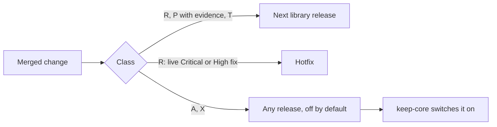

# Release policy

This policy controls how changes in this library reach a release. It has two goals: the smallest number of releases, and no release that breaks the consumer or a ceremony between parties that run different versions. The day-to-day process is in [release-streams.md](release-streams.md). The steps to cut and tag a release are in [release-process.md](release-process.md).

## Core rule

A release never breaks a mixed-version deployment. When some parties run the new release and others run the previous one, every keygen and signing ceremony that worked before still completes.

This library reaches the node fleet only through the tss-lib pin in `threshold-network/keep-core`. keep-core decides when a change is switched on for the fleet. A change that old and new parties cannot share ships switched off in this library: the default behavior stays compatible, and a caller turns the change on explicitly (for example by selecting `tss.ProtocolModeSecurityV2`).

## Compatibility classes

Each change has one class. The author records it in the "Breaking change" field of the pull request template. A CI check (`required-answers`) requires exactly one answer.

| Class | What the change does | Template answer | Where it ships |
|---|---|---|---|
| R: local | Changes only local behavior: input validation, error returns instead of panics, performance, constant-time arithmetic with identical results, logs. | No | The next library release. A hotfix only under the hotfix rule. |
| P: verifier strictness | Changes which peer messages or proofs a party accepts. | No, with evidence | Like R, but only if the PR shows that honest messages from the previous release still verify (for example with the mixed-binary harness in `testdata/legacy_transcript`). Without that evidence, treat it as A. |
| A: coordinated activation | Adds or changes a ceremony parameter that every party must agree on, for example the session nonce or the message width `fullBytesLen`. | Yes, coordinated activation | Any release, switched off or optional by default. keep-core switches it on for all parties at one agreed point. |
| X: cutover | Changes protocol messages, proof transcripts or Fiat-Shamir challenges, session binding, or key-share or pre-parameter serialization, so old and new parties cannot complete one ceremony. A public Go API break for the keep-core consumer also counts. | Yes, cutover | Any release, behind an explicit caller selection. keep-core plans the cutover. |
| T: tooling | Changes only CI, docs or tests. | Not applicable | Any time, on the branch that owns it. |

Rules for special cases:

1. A dependency upgrade that changes a value inside a transcript, a hash or a curve operation that peers must agree on is class X. If it only changes local behavior, it is class R.
2. A change to the minimum Go version is class R, with a line under "Breaking changes" in `CHANGELOG.md`, because consumers' builders may need an update.
3. If one change has two classes, split it into two PRs. Each PR follows the rule for its class.

## Versions

- The module path is `github.com/bnb-chain/tss-lib`, without a `/vN` suffix. The `go` command accepts only `v0.x` and `v1.x` tags for this path, so releases stay on the `v1.x` line. The `v2.x` and `v3.x` tags in this repository belong to upstream's `/v2` and `/v3` modules; do not reuse those numbers.
- The first release of this fork is `v1.4.0`, after upstream's `v1.3.5`.
- Use plain release versions (`v1.4.0`, `v1.4.1`). Do not add a pre-release suffix such as `-threshold.1` to a release: `go get ...@latest` prefers a release over a pre-release, so it would select the older upstream `v1.3.5`.
- A minor version (`v1.5.0`) carries new features and breaking changes; a patch version (`v1.4.1`) carries only class R and T changes. A major version would need a module-path change, which needs a decision by the maintainers. Every breaking change is listed under "Breaking changes" in `CHANGELOG.md`.
- A tag is never moved or deleted (a ruleset enforces this). A bad release is fixed by a new version.

## Number of releases

- The project has two release owners. They decide when to cut a release.
- There is no release calendar. A release is cut when the `dev` line has changes that keep-core needs, or when enough fixes collect.
- A hotfix is a release outside this rule. It is allowed only for a fix to a live, exploitable finding rated Critical or High. Both release owners must agree. It carries only class R changes. It branches from the last release tag; there is no standing hotfix branch.

## Approvals

- Every change reaches `dev` and `master` through a PR. CI must pass.
- A PR into `dev` or `master` needs an approval from a reviewer who is not its author.
- A release tag needs an explicit go from a release owner. A hotfix needs a go from both release owners.
- Only organization admins can create a `v*` tag (a ruleset enforces this). A release owner who is not an admin asks an admin to push the tag after giving the go.

## Security fixes

- Report a vulnerability through the repository's private vulnerability reporting, not in a public issue or PR.
- An embargoed fix is prepared privately. Its public PR opens only when the release owners decide to disclose it. PR text, commit messages, test names and CI logs never contain the finding before that.

## Stream tracking

- Each release stream has one parent PR. It lists the stream's breaking changes, the PRs merged into the stream and the open PRs in merge order.
- A parent PR targets `master`.
- The parent body is updated when a child PR merges.

## Current cycle

- One stream: the `dev` line into `master`. Parent PR: #37.
- Release: `v1.4.0`, tagged on `master` after #37 merges. Consumer: the keep-core pin.
- Release owners: `piotr-roslaniec` and `lrsaturnino`.
