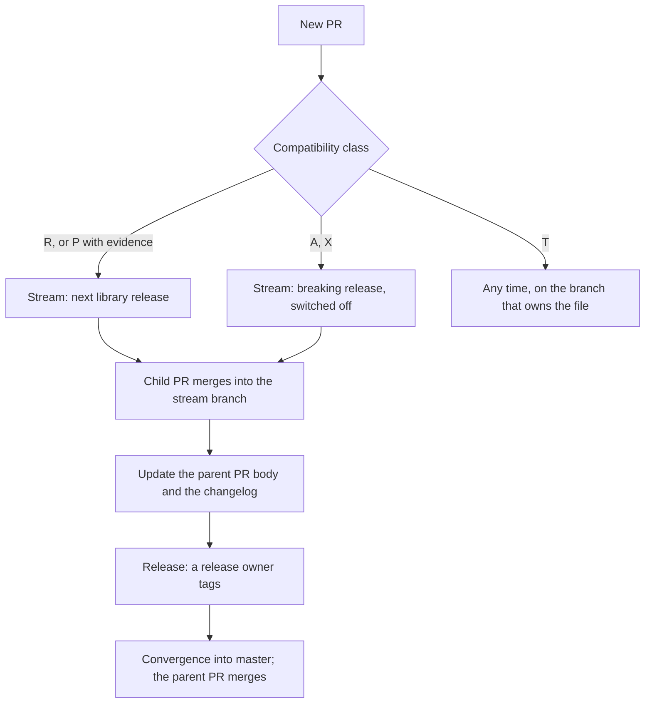

# Release streams: how a change gets from a PR to a release

[release-policy.md](release-policy.md) sets the rules: which changes may ship where, how many releases there are, and how a breaking change is switched on. This document is the working process that applies those rules day to day: how to sort changes into streams, how to describe them in PRs, how each stream is tracked, and how the changelog is kept. For the steps to cut and tag a release, see [release-process.md](release-process.md).

Agents use the `release-streams` skill (`.claude/skills/release-streams/SKILL.md`), which follows this document.

## 1. Terms

- **Stream**: one line of work that ships as one release. A stream has one branch and one parent PR.
- **Parent PR**: a PR from the stream's branch into `master` that tracks the stream. It has the `release-stream-parent` label. It merges only at convergence, after the stream's release.
- **Child PR**: a normal PR that merges into a stream's branch (or into a branch of a stack on that line).
- **Breaking change**: a change that old and new versions cannot run side by side. Classes A and X in the policy.
- **Activation switch**: the caller selection that turns a class A or X change on (for example `tss.ProtocolModeSecurityV2`). The change is off in this library and on only when keep-core selects it.
- **Convergence**: merging the stream branch back into `master` after the release.

## 2. The process at a glance



## 3. Keep the number of streams small

1. The release owners fix the release set for a cycle first, in writing (the "Current cycle" section of the policy). Every open PR goes into one of those streams. A new stream needs a decision by both release owners.
2. One stream for each release, not for each topic. Non-breaking work joins the next library release. When a breaking release is planned, it also carries the non-breaking work that is ready, so there is no extra release before it.
3. After a breaking release, further breaking changes wait for the next breaking release. There is no release calendar for non-breaking work.
4. One fix, one canonical PR per release line. When the same fix exists on two lines, the release plan names the canonical PR, and the copies close with a comment that names it. Before a copy closes, port anything it has that the canonical PR lacks.
5. A PR that has two classes is split into two PRs.

## 4. Breaking changes go into their own stream

1. A breaking change ships switched off. It has no effect until a caller selects it.
2. Before keep-core switches it on, a node with the change behaves exactly like a node without it. A mixed-version test proves this.
3. All breaking changes of one release are switched on at one agreed point in keep-core.
4. keep-core sets that point last, after the library release is tagged and after a rehearsal on the test network with a ceremony that straddles the switch, with operator notice on the keep-core side. This library sets no block height: it has no chain.
5. Before the tag, check that the release branch contains the mixed-version test for every breaking change it carries. A branch that carries a breaking change without its mixed-version test can break a mixed fleet as soon as a consumer selects it.

## 5. Describe every change in its PR

Every PR uses [the PR template](../.github/pull_request_template.md):

- **Breaking change**: tick exactly one answer. If the answer is "Yes", name the message, transcript, challenge, serialization or API surface that changes, the caller selection that switches the change on, and why the change cannot be backward compatible.
- **Release stream**: tick the stream the change ships in.
- **Security**: tick exactly one answer. Give severity and the finding ID; never put embargoed detail in the PR.
- **Testing**: the commands and results, and which new test fails without the change.
- **Rollback**: how to undo the change (re-pin the previous library version in keep-core, revert the change, or both).

The `PR description` workflow ([pr-description.yml](../.github/workflows/pr-description.yml), job `required-answers`) fails the PR unless exactly one "Breaking change" box and exactly one "Security" box are ticked.

GitHub runs no `pull_request` check while a PR conflicts with its base. For such a PR (a parent PR often conflicts until convergence), check the body against the two patterns locally before saving it:

```
^[[:space:]]*[-*] \[[xX]\] \*\*(No|Yes, coordinated activation|Yes, cutover|Not applicable)\*\*
^[[:space:]]*[-*] \[[xX]\] \*\*(Not security-related|Security fix)\*\*
```

## 6. Track each stream in its parent PR

Find the parents with: `gh pr list --label release-stream-parent`.

A parent PR:

- targets `master`;
- has the title `chore(release): track the <stream> stream (<branch> into master)`;
- opens when the stream starts, or with its first child PR.

Its body is the PR template plus a `## Stream tracking` section:

1. **Breaking changes in this stream**: a table of class, change, PR, and the caller selection that switches it on. For a non-breaking stream, "None" and the reason.
2. **Merged into this stream**: a table of PR, target branch and date, including merges into stack branches. PRs closed without merge are listed with the reason.
3. **Open PRs, in merge order**: numbered, stacks bottom-up.
4. **Release gates**: what must be true before the tag, and which steps only a human may do.
5. A note when the PR conflicts with `master` (see section 5).

Update rule: when a child PR merges, closes or opens, the parent body is updated the same day. Fetch the live PR list first, because others merge too.

## 7. Merge mechanics

- Every child PR merges after a reviewer who is not its author approves it and CI passes.
- Stacks merge bottom-up. Retarget the children of a branch before that branch merges. Do not delete a branch that is the base of an open PR: GitHub closes the child PR, and a later merge into the orphaned branch never reaches the stream.
- Update branches with merge commits. Never force-push a release line. This repository merges with merge commits only; squash and rebase are disabled.
- A tag needs an explicit go from a release owner.

## 8. Changelog and breaking-change notes

- `CHANGELOG.md` follows [Keep a Changelog](https://keepachangelog.com/en/1.1.0/). The PR that changes behavior adds its line under `## [Unreleased]` (Added, Changed, Fixed, Security, Removed), ending with the PR number. The release commit moves `[Unreleased]` to the version heading. Security lines describe the behavior, never the finding.
- Every breaking change is listed under "Breaking changes" in `CHANGELOG.md`, with the caller selection that enables it and the upgrade path for the keep-core consumer.

## 9. Checklist for a new PR

1. Pick the compatibility class (policy, "Compatibility classes"). Split the PR if it has two.
2. Pick the stream from the class and the current cycle. Base the PR on that stream's branch.
3. Fill in the template: breaking change and its caller selection, or the evidence for class P.
4. Add the changelog line.
5. After it merges, update the parent PR (section 6).
